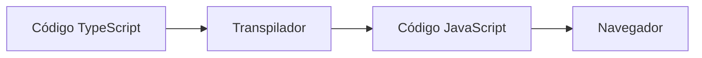

---

title: UP03 · Introducción a TypeScript

---


**TypeScript** es un lenguaje de programación desarrollado sobre JavaScript que incorpora un sistema de tipos estático. Todo código JavaScript válido puede formar parte de un programa TypeScript, pero TypeScript añade herramientas que permiten detectar errores antes de ejecutar la aplicación.

Los navegadores no ejecutan TypeScript directamente. El código debe transformarse previamente en JavaScript mediante un proceso denominado **transpilación**.



### 2.1. Ventajas de TypeScript

El uso de TypeScript aporta principalmente:

- Detección anticipada de errores.
- Mayor claridad sobre los datos utilizados.
- Mejor autocompletado en el editor.
- Facilita la modificación y el mantenimiento del código.
- Permite describir objetos mediante tipos e interfaces.
- Mejora el trabajo con aplicaciones de tamaño medio o grande.

JavaScript permite cambiar el tipo de una variable durante la ejecución:

```js
let precio = 35;
precio = "treinta y cinco";
```

TypeScript puede detectar esta modificación como un error:

```ts
let precio: number = 35;
precio = "treinta y cinco";
```

!!! importante "Importante"

    TypeScript ayuda a prevenir errores durante el desarrollo, pero el código que finalmente se ejecuta en el navegador continúa siendo JavaScript.


!!! salto-pagina-pdf ""

### 2.2. Anotación e inferencia de tipos

Podemos indicar explícitamente el tipo de una variable mediante una **anotación de tipo**:

```ts
const nombreEvento: string = "Festival Mediterránea";
const precioEntrada: number = 35;
const disponible: boolean = true;
```

Sin embargo, TypeScript también puede deducir el tipo a partir del valor asignado. Este mecanismo se denomina **inferencia de tipos**:

```ts
const nombreEvento = "Festival Mediterránea";
const precioEntrada = 35;
const disponible = true;
```

En ambos casos, TypeScript considera que `nombreEvento` es una cadena, `precioEntrada` es un número y `disponible` es un valor booleano.

Siempre que el tipo resulte evidente, se recomienda aprovechar la inferencia para evitar anotaciones innecesarias.

### 2.3. Tipos básicos

Los tipos básicos utilizados inicialmente serán:

| Tipo | Finalidad | Ejemplo |
|---|---|---|
| `string` | Representar texto | `"FestWeb"` |
| `number` | Representar valores numéricos | `25.50` |
| `boolean` | Representar condiciones lógicas | `true` |
| `null` | Indicar la ausencia intencionada de un valor | `null` |
| `undefined` | Indicar que todavía no existe un valor | `undefined` |

```ts
const titulo: string = "Festival de verano";
const aforo: number = 5000;
const requiereMayoriaEdad: boolean = false;
let fechaCancelacion: null = null;
```

!!! salto-pagina-pdf ""

### 2.4. Tipos unión

Un **tipo unión** permite que una variable admita más de un tipo de dato. Las posibilidades se separan mediante el carácter `|`.

```ts
let identificador: number | string;

identificador = 25;
identificador = "EV-25";
```

También podemos limitar una variable a un conjunto concreto de valores:

```ts
let estado: "programado" | "agotado" | "cancelado";

estado = "programado";
```

Esta opción evita asignar estados no contemplados por la aplicación.

### 2.5. Los tipos `any` y `unknown`

El tipo `any` desactiva las comprobaciones de TypeScript sobre un valor:

```ts
let dato: any = "FestWeb";
dato = 45;
dato.metodoInexistente();
```

Su uso elimina gran parte de las ventajas del tipado, por lo que debe evitarse salvo que sea imprescindible.

El tipo `unknown` permite recibir un valor cuyo tipo todavía no conocemos, pero obliga a comprobarlo antes de utilizarlo:

```ts
let dato: unknown = "FestWeb";

if (typeof dato === "string") {
  console.log(dato.toUpperCase());
}
```

!!! consejo "Buena práctica"

    Utiliza tipos concretos siempre que sea posible. Si el tipo de un dato es desconocido, resulta más seguro emplear `unknown` que `any`.

!!! salto-pagina-pdf ""

### 2.6. Comprobación de tipos

El operador `typeof` permite comprobar determinados tipos durante la ejecución:

```ts
const valor: string | number = "Festival Mediterránea";

if (typeof valor === "string") {
  console.log(valor.toUpperCase());
} else {
  console.log(valor.toFixed(2));
}
```

TypeScript analiza la condición y conoce el tipo concreto de `valor` dentro de cada bloque. Este proceso se denomina **estrechamiento de tipos** o *type narrowing*.

### 2.7. Errores de compilación y errores de ejecución

TypeScript puede detectar errores antes de ejecutar el programa:

```ts
const precio: number = "35";
```

Este código produce un **error de compilación** porque una cadena no puede asignarse a una variable numérica.

Sin embargo, TypeScript no impide todos los posibles fallos. Algunos problemas solo aparecen durante la ejecución, especialmente cuando se reciben datos externos o se aplica una lógica incorrecta.

!!! pregunta "Comprueba tu comprensión"

    ¿Qué ventaja aporta TypeScript si el navegador termina ejecutando JavaScript?

    
!!! salto-pagina-pdf ""